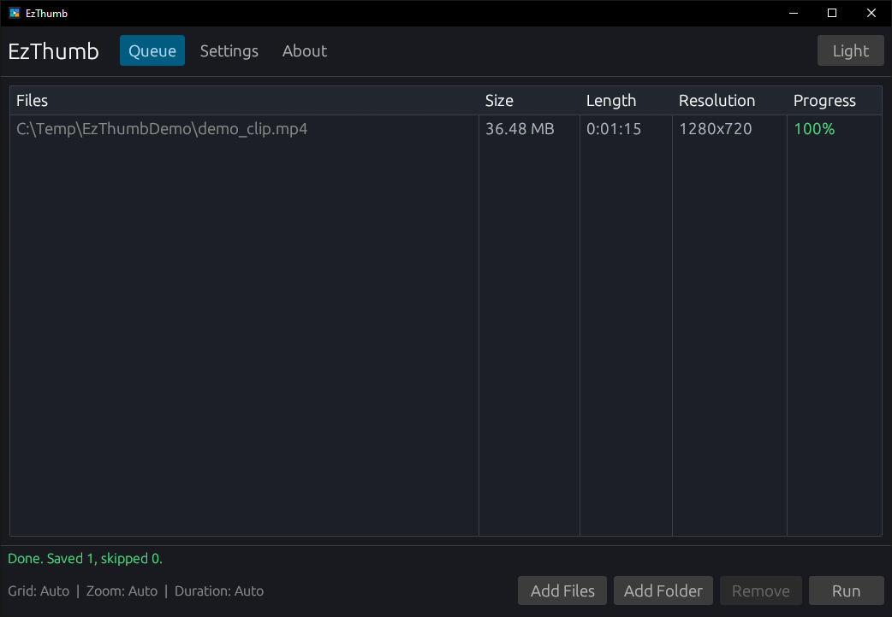
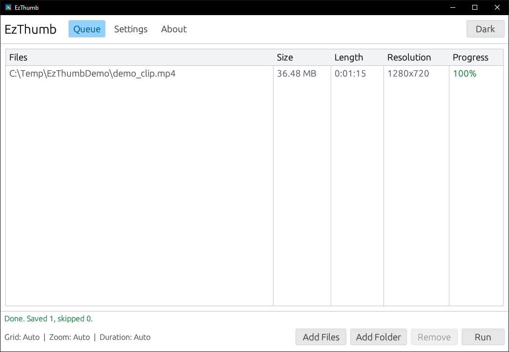
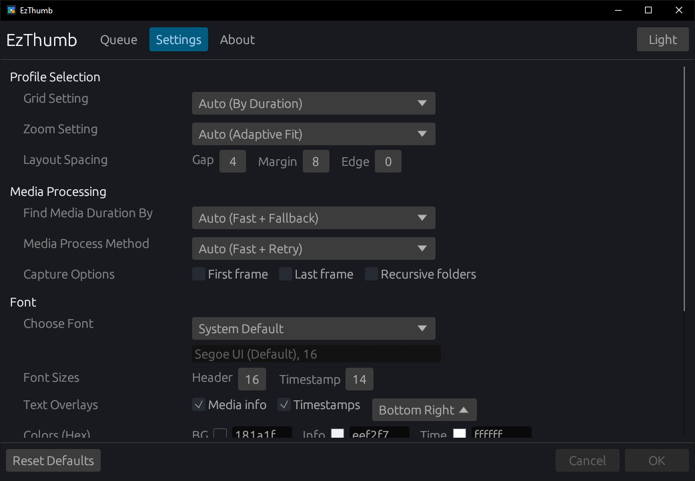
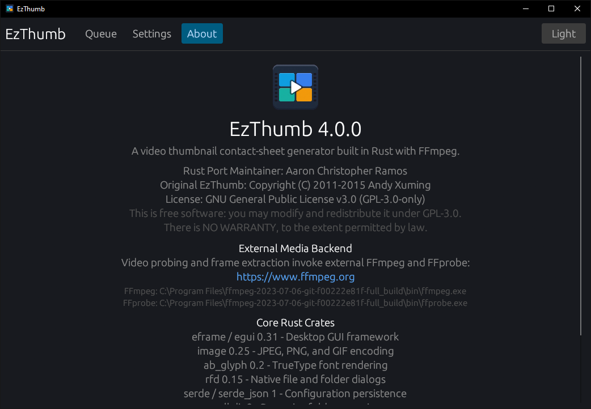
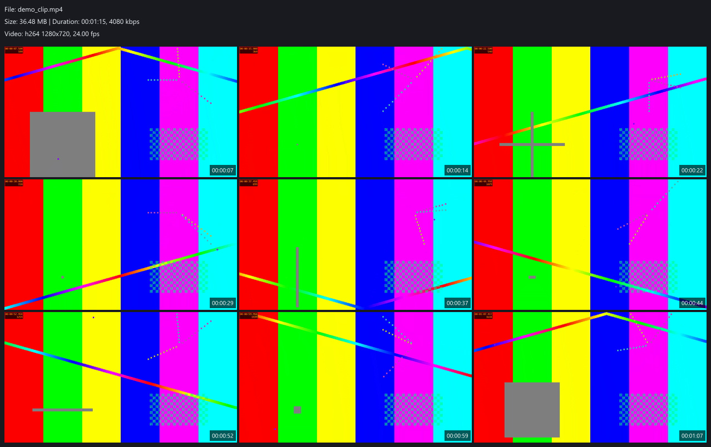

# EzThumb (Rust)

Generate video thumbnail contact sheets, individual frame snapshots, and animated GIF previews from the command line or desktop GUI.

## Introduction

**EzThumb** is a cross-platform Rust rewrite of [xuminic/ezthumb](https://github.com/xuminic/ezthumb) that builds as a single standalone binary with both a command-line interface and a native `eframe/egui` desktop GUI. It invokes external `ffmpeg` and `ffprobe` binaries for broad container and codec support without bundling legacy C or FFmpeg DLLs.

Running `ezthumb` with no file arguments (or with `-G` / `--gui`) opens the desktop GUI with a 5-column batch Queue table (`Files`, `Size`, `Length`, `Resolution`, `Progress`), a 5-section Settings tab, an About tab, Dark and Light themes, and `1.5x` scaled typography. Passing video files or directories runs headless batch processing directly in the terminal.

## Screenshots

### Queue Tab (Dark Mode)



### Queue Tab (Light Mode)



### Settings Tab



### About Tab



### Sample Generated Contact Sheet



## Features

- **FFmpeg and FFprobe backend:** Supports modern video containers and codecs (H.264, H.265/HEVC, VP9, AV1, MP4, MKV, AVI, MOV, WebM, TS) through external `ffmpeg` and `ffprobe` on `PATH`.
- **Adaptive and custom grid profiles:** Supports `Auto (By Duration)`, `Column and Row (Fixed Grid)`, `Column and Step (Time Step)`, `Discrete by Number (Separate Frames)`, `Discrete by Step (Separate Interval)`, and `Discrete Key Frames (I-Frames)`.
- **Flexible zoom and output formats:** Supports `Auto (Adaptive Fit)`, `Zoom by Ratio (Percentage)`, `Zoom by Canvas (Canvas Width)`, and `Zoom by Size (Fixed Tile Size)`, saving `JPEG` (default quality `95`), `PNG`, `GIF`, and `Animated GIF` (with optional transparency layer).
- **Duration scanning and seek methods:** Provides `Auto`, `Fast Scan`, `Full Scan (Deep Probe)`, and `File Head` probing plus `Auto`, `Upon Key Frames (Fast)`, `Frame by Frame (Accurate)`, `Single Pass`, `Two Pass`, `Safe Mode`, and `Key Frame Rip` frame extraction.
- **Typography and metadata overlays:** Renders configurable media info headers and per-frame timestamps using `System Default`, `Choose From System` (live OS font discovery), or `Custom Font File` (`.ttf`/`.otf`) via `ab_glyph` with a built-in bitmap fallback.
- **Desktop GUI (`eframe/egui`):** Includes a Dark/Light theme toggle, `1.5x` scaled typography, background `ffprobe` queue metadata loading, drag-and-drop queuing, per-row progress tracking, double-click output viewing, and dirty-state `Cancel`/`OK` settings management.

## Requirements

Install **FFmpeg** (`ffmpeg` and `ffprobe`) on your `PATH`, or place `ffmpeg.exe` and `ffprobe.exe` next to `ezthumb.exe`.

## How to Use

### Desktop GUI

1. Launch `ezthumb` with no arguments (or `ezthumb --gui`).
2. Add videos with **Add Files**, **Add Folder**, or drag-and-drop. The Queue table populates `Size`, `Length`, and `Resolution` automatically via `ffprobe`.
3. Open **Settings** to configure **Profile Selection**, **Media Processing**, **Font**, **Output Directory**, and **Output Thumbnails**, then click **OK** to save.
4. Click **Run** on the **Queue** tab to process all queued files. Double-click any completed row to open the generated thumbnail image.

### Command Line Examples

Generate a contact sheet using the default `Auto` grid and `JPEG` (`quality 95`) profile:

```powershell
ezthumb sample.mp4
```

Generate a `3x4` transparent PNG sheet at `1600 px` width without the header block:

```powershell
ezthumb -g 3x4 -w 1600 -m png --transparent --opt-info off sample.mp4
```

Extract `10` separate numbered PNG screenshots from `10%` to `90%` of the video:

```powershell
ezthumb -g 0x10 -m png --time-from 10% --time-end 90% sample.mp4
```

Generate a transparent animated GIF preview (`800 ms` per frame):

```powershell
ezthumb -g 3x4 -s 320x180 -m gif@800 --transparent sample.mp4
```

Print short or detailed media metadata without generating images:

```powershell
ezthumb -i sample.mp4
ezthumb -I sample.mp4
```

## Build and Test

Install Rust (`stable-x86_64-pc-windows-msvc` on Windows, or stable Rust on Linux/macOS), then run:

```powershell
cargo fmt --all -- --check
cargo test
cargo clippy --all-targets -- -D warnings
cargo build --release
```

The standalone executable builds to `target\release\ezthumb.exe` (or `target/release/ezthumb` on Unix).

## Attribution and Credits

- Original concept, C implementation, and CLI specification by **Andy Xuming** at [xuminic/ezthumb](https://github.com/xuminic/ezthumb).
- Media probing and frame decoding powered by [FFmpeg](https://ffmpeg.org/).
- Original project inspired by **movie thumbnailer (`mtn`)**.

## License

GNU General Public License v3.0 (`GPL-3.0-only`). Refer to `COPYING`.
